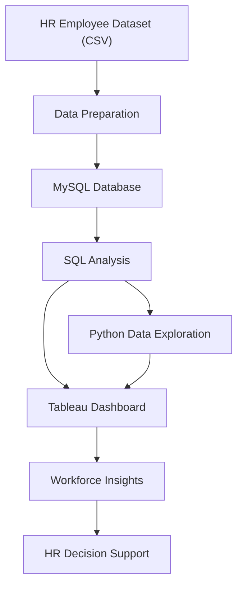

# 📊 HR Analytics Dashboard – Workforce Intelligence & Performance Analysis

<p align="center">
  <strong>Turning Employee Data into Actionable Workforce Insights</strong>
</p>

<p align="center">
  An end-to-end HR analytics project that combines MySQL database management, SQL-driven data analysis, Python-based data exploration, and Tableau visualization to understand workforce demographics, employee attrition, job satisfaction, performance, and salary distribution.
</p>

<p align="center">
  
  
  
  
  
</p>

---

## 📌 Vision & Problem Statement

Organizations generate large amounts of employee information, but understanding workforce trends and identifying important HR patterns requires structured data analysis.

Traditional HR reporting often makes it difficult to identify employee attrition trends, salary differences, workforce demographics, and performance patterns.

**HR Analytics Dashboard** addresses this challenge by building a structured analytical workflow that transforms raw employee records into meaningful insights.

The project integrates employee data into MySQL, applies SQL queries for analytical exploration, uses Python for data analysis, and presents workforce insights through Tableau dashboards.

### 🎯 Project Objectives

- Analyze employee attrition and workforce distribution.
- Understand employee demographics and department-wise statistics.
- Evaluate job satisfaction and performance patterns.
- Explore employee income and salary distribution.
- Identify workforce trends through structured SQL analysis.
- Present meaningful HR insights through interactive visualizations.

---

## ⚙️ Key Features & Analytical Capabilities

| Capability | What It Does | Business Value |
|---|---|---|
| Employee Data Management | Stores employee records in MySQL | Structured data management |
| Data Processing | Loads and prepares employee datasets | Reliable analytical data |
| SQL Analytics | Executes analytical queries | Workforce insights |
| Attrition Analysis | Examines employee turnover patterns | Retention understanding |
| Salary Analysis | Explores employee income distribution | Compensation insights |
| Performance Analysis | Evaluates employee performance metrics | Performance monitoring |
| Demographic Analysis | Studies workforce characteristics | Workforce understanding |
| Tableau Visualization | Presents analytical results | Data-driven decisions |

---

## 🏗️ System Architecture

The project follows a structured data analytics pipeline:



### 🔄 Data Processing Workflow

1. **Data Ingestion:** Import employee attrition records from CSV.
2. **Database Management:** Store employee information in MySQL.
3. **Data Preparation:** Create database tables and load employee records.
4. **SQL Analysis:** Execute analytical queries to understand workforce metrics.
5. **Exploratory Analysis:** Explore employee trends using Python.
6. **Visualization:** Present analytical findings through Tableau.
7. **Insights:** Interpret workforce patterns to support HR decision-making.

---

## 🛠️ Technology Stack

| Layer | Technology | Purpose |
|---|---|---|
| Programming Language | Python 3.8+ | Data exploration and processing |
| Database | MySQL 8.x | Employee data storage |
| Query Language | SQL | Data extraction and analytical queries |
| Data Source | CSV | HR employee dataset |
| Data Analysis | Python | Exploratory data analysis |
| Visualization | Tableau | Interactive HR dashboards |
| Development | VS Code / Jupyter | Development and analysis |
| Version Control | Git & GitHub | Source code management |

---

## 📂 Project Structure

```text
HR-Anaytics-Dashboard/
│
├── dashboard/
│   └── HR_Analytics_Dashboard.twbx
│
├── data/
│   └── HR_Employee_Attrition.csv
│
├── images/
│   └── dashboard_preview.png
│
├── notebooks/
│   └── hr_data_analysis.py
│
├── sql/
│   ├── create_table.sql
│   ├── load_data.sql
│   └── analysis_queries.sql
│
└── README.md
```

---

## ⚡ Quickstart Guide

### 1. Clone Repository

```bash
git clone https://github.com/Sravanth-Kumar-Kuricheti/HR-Anaytics-Dashboard.git

cd HR-Anaytics-Dashboard
```

### 2. Install Prerequisites

Make sure you have installed:

- Python 3.8 or higher
- MySQL Server 8.x
- Tableau Desktop or Tableau Public
- Git

### 3. Configure MySQL Database

Start your MySQL server and create the database:

```sql
CREATE DATABASE hr_analytics;

USE hr_analytics;
```

Ensure that MySQL local data loading is enabled if you use the provided CSV loading workflow.

### 4. Create Database Tables

Execute the SQL scripts in the following order:

```text
sql/create_table.sql
sql/load_data.sql
sql/analysis_queries.sql
```

Run them through MySQL Workbench or the MySQL command-line client.

### 5. Perform Python Data Analysis

Open the Python analysis file in the notebooks directory using VS Code or Jupyter and execute the analysis.

### 6. Build Tableau Dashboard

1. Open Tableau Desktop.
2. Connect Tableau to your MySQL database.
3. Select the prepared HR employee data.
4. Create visualizations using the analytical metrics.
5. Save the resulting Tableau workbook inside the dashboard directory.

---

## 📊 Business Insights & Analysis Areas

The project focuses on the following analytical dimensions:

- Employee Attrition: Understand employee turnover patterns.
- Workforce Demographics: Explore employee distribution.
- Department Analysis: Compare workforce across departments.
- Job Satisfaction: Examine employee satisfaction metrics.
- Performance Analysis: Understand performance patterns.
- Income Distribution: Explore salary and compensation trends.

---

## 🚀 Future Enhancements

- Build automated monthly HR reporting.
- Add advanced employee attrition prediction using Machine Learning.
- Develop interactive KPI monitoring.
- Integrate additional workforce performance metrics.
- Implement automated data quality validation.

---

## 👨‍💻 Author

**Sravanth Kumar Kuricheti**

B.Tech – Artificial Intelligence & Data Science

- GitHub: https://github.com/Sravanth-Kumar-Kuricheti
- LinkedIn: https://www.linkedin.com/in/sravanthkumarkuricheti/

---

<p align="center">
  ⭐ If you find this project useful, consider giving it a star!
</p>

**HR Analytics Dashboard | Data Analytics | SQL | MySQL | Tableau**
